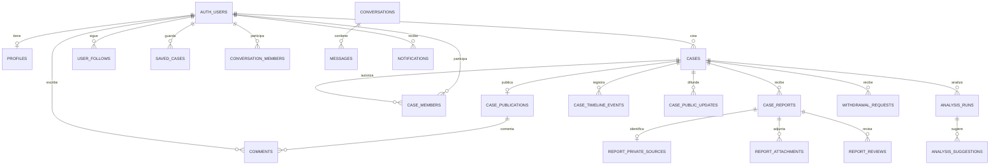

# WayFinder: modelo conceptual inicial de datos y permisos

**Estado:** propuesta para revisar antes de crear migraciones  
**Equipo:** Pamela y Michael  
**Aplicación:** WayFinder V1; desarrollo y pruebas con casos ficticios o autorizados

## 1. Para qué sirve este documento

Este es un diseño conceptual inicial basado en el overview del producto, los requerimientos y las pantallas compartidas. Define entidades, relaciones y una matriz de acceso para que Pamela y Michael puedan revisar el dominio antes de seleccionar la tecnología.

Los PDFs de requerimientos enumeran funciones, pero no detallan cada campo ni política. Por tanto, los campos y reglas marcados como propuesta deben ser revisados por ambos antes de escribir las migraciones. Este documento no afirma que las tablas o políticas ya existan.

## 2. Reglas que el esquema debe cumplir

1. Mantener separada la **publicación pública** del **expediente privado**.
2. Separar el **reporte** de la **identidad/contacto de quien lo envía**. El Editor puede revisar reportes, pero no ver quién los envió ni sus datos de contacto.
3. No guardar ubicación exacta, fotos privadas, datos de nacimiento ni contacto en tablas o respuestas que la zona pública pueda consultar.
4. Aplicar controles de acceso del lado del servidor a todas las tablas y políticas propias a los archivos. La interfaz nunca es la barrera de acceso.
5. Dar a visitantes una ruta segura para reportar o solicitar protección sin permitirles leer tablas privadas ni insertar datos arbitrarios.
6. El análisis solo crea sugerencias para revisión humana. No confirma identidad, no cambia el reporte fuente y no lo elimina.
7. Los roles de caso se asignan por expediente. Moderador y Administrador son roles globales que nunca se obtienen desde el registro del cliente.
8. La V1 no crea cuentas para menores. Las publicaciones de casos de menores deben tener campos públicos reducidos.

## 3. Diagrama de relaciones propuesto

`AUTH_USERS` representa el registro que administrará el futuro proveedor de identidad; no se debe duplicar su contraseña ni su correo de acceso en una tabla pública. Las relaciones y tablas de este diagrama son propuestas, no migraciones aplicadas.

## 4. Tablas iniciales y clasificación de campos

La clasificación de la columna se refiere a la sensibilidad general de la tabla. Las columnas públicas se deben seleccionar explícitamente; nunca se debe devolver una fila privada completa y confiar en que la pantalla oculte los campos.

| Tabla propuesta | Para qué sirve y campos iniciales | Clasificación | Acceso esperado |
| --- | --- | --- | --- |
| `profiles` | Perfil visible: `user_id`, `display_name`, `username`, `avatar_public_path`, `bio_public`, `created_at`. No incluye correo de acceso, teléfono ni fecha de nacimiento. | Pública con campos limitados | Lectura pública del perfil publicado; edición del propio perfil. |
| `account_eligibility` | Marca mínima de aceptación de mayoría de edad: `user_id`, `adult_confirmed_at`, `terms_accepted_at`, `updated_at`. No almacenar fecha de nacimiento salvo que el equipo justifique y apruebe esa necesidad. | Privada | El usuario puede leer su estado; creación/cambio mediante flujo seguro. |
| `cases` | Registro interno: `id`, `owner_user_id`, `subject_type`, `internal_status`, `created_at`, `updated_at`, `closed_at`. Sin descripción pública, contacto ni ubicación exacta. | Privada | Responsable y Editor del expediente; creación ligada al usuario autenticado por función segura. |
| `case_publications` | Proyección autorizada: `case_id`, `publication_status`, `public_name_or_alias`, `public_summary`, `age_range`, `country`, `city_or_general_area`, `last_seen_date_approx`, `public_description`, `public_image_path`, `published_at`, `is_minor_limited`. | Pública cuando está publicada | Visitantes leen solo publicaciones públicas activas; Responsable administra la publicación. Los campos de menores se limitan. |
| `case_members` | Acceso por expediente: `case_id`, `user_id`, `case_role` (`owner` o `editor`), `membership_status`, `created_at`. | Privada | El propio miembro puede ver su pertenencia; solo Responsable gestiona Editores. |
| `case_reports` | Contenido de una pista: `id`, `case_id`, `report_type`, `description`, `event_date_approx`, `general_area`, `report_status`, `created_at`, `updated_at`. Evitar guardar aquí contacto o `auth.users.id` visible al Editor. | Privada | Responsable y Editor ven lo necesario para revisar; visitantes no consultan filas. |
| `report_private_sources` | Vínculo y contacto: `report_id`, `submitter_user_id` nullable, `contact_email`, `contact_phone`, `visitor_token_hash`, `created_at`. Separado del reporte. | Sensible | Responsable del expediente; acceso excepcional y auditado de Moderador solo por solicitud concreta. Nunca Editor. |
| `report_attachments` | Metadatos de adjuntos: `id`, `report_id`, `bucket`, `object_path`, `mime_type`, `created_at`, `processing_status`. | Sensible | Responsable y Editor pueden recibir acceso autorizado al archivo del reporte; enlace firmado temporal. No público. |
| `report_reviews` | Revisión humana: `report_id`, `reviewer_user_id`, `classification`, `internal_note`, `created_at`. | Privada | Responsable y Editores del expediente pueden crear/leer revisiones; no altera el reporte fuente. |
| `case_timeline_events` | Eventos internos del expediente: `case_id`, `event_type`, `description`, `event_at`, `created_by`. | Privada | Responsable y Editor; si se difunde, crear actualización pública separada. |
| `case_public_updates` | Actualizaciones publicables: `case_id`, `author_user_id`, `body_public`, `publication_status`, `published_at`. | Pública al publicarse | Lectura pública si está activa; solo Responsable publica; Editor puede preparar borrador si así se acuerda. |
| `case_audit_log` | Historial append-only: `case_id`, `actor_user_id`, `action`, `entity_type`, `entity_id`, `created_at`, `safe_change_summary`. | Privada | Lectura autorizada de historial; inserción solo por trigger/función segura; ningún rol de usuario edita o borra. No guardar copias de datos sensibles en `safe_change_summary`. |
| `analysis_runs` | Ejecuciones: `case_id`, `started_at`, `completed_at`, `algorithm_version`, `status`. | Privada | Lectura por Responsable/Editor; inserción por función segura. |
| `analysis_suggestions` | Sugerencias: `run_id`, `source_report_id`, `compared_report_id`, `suggestion_type`, `explanation`, `human_review_status`, `created_at`. | Privada | Responsable/Editor; salida no verificada, no evidencia; no modifica reportes. |
| `withdrawal_requests` | Solicitud de retirada/protección: `id`, `case_id` nullable, `report_id` nullable, `request_type`, `status`, `tracking_token_hash`, `created_at`, `resolved_at`. | Privada/sensible | Visitante crea mediante función segura del backend y consulta estado con token; Moderador revisa; Responsable ve lo mínimo necesario para ejecutar una decisión, sin contacto del solicitante. |
| `request_private_data` | Datos de contacto o detalles delicados asociados a solicitud: `request_id`, `contact_data`, `sensitive_details`. | Sensible | Solo Moderador asignado, mediante flujo seguro y auditado. |
| `moderation_reports` | Denuncias sobre contenido/usuario: `id`, `reporter_user_id`, `target_type`, `target_id`, `reason`, `status`, `created_at`. | Privada/sensible | Persona denunciante consulta su estado; Moderador asignado revisa; no se publica en feed. |
| `global_roles` | Roles globales: `user_id`, `role` (`moderator` o `administrator`), `granted_by`, `created_at`. | Privada/crítica | Solo función segura de administración; ningún cliente puede asignarse o elevar roles. |
| `comments` | Comentarios públicos: `id`, `publication_id`, `author_user_id`, `body`, `parent_id`, `status`, `created_at`. | Pública si está activa | Lectura pública; usuario autenticado crea/edita/elimina los propios según reglas; moderación por función autorizada. |
| `reactions` | Reacciones: `user_id`, `publication_id`, `reaction_type`, `created_at`. | Privada del usuario/pública agregada | Usuario gestiona la propia; interfaz no debe exponer actividad privada si no se aprueba. |
| `user_follows` / `case_follows` | Seguimiento de perfiles/casos: `follower_user_id`, `followed_user_id` o `case_id`, `created_at`. | Privada del usuario | Usuario consulta y cambia solo sus propios seguimientos. |
| `saved_cases` | Casos guardados: `user_id`, `case_id`, `created_at`. | Privada | Solo el usuario dueño. |
| `conversations`, `conversation_members`, `messages` | Mensajería: conversación, participantes, contenido y timestamps. | Sensible/privada | Solo participantes; moderación solo ante reporte y con alcance mínimo. Visitantes no leen ni envían mensajes privados. |
| `notifications` | Avisos: `id`, `recipient_user_id`, `event_type`, `safe_reference_id`, `read_at`, `created_at`. | Privada | Solo destinatario. El payload no contiene ubicación, contacto ni texto de reportes privados. |

### Observaciones sobre el modelo

- `cases` y `case_publications` son entidades distintas: el feed no consulta `cases` para construir tarjetas públicas.
- No usar un `is_public` en una tabla con todos los datos para después mostrar solo algunos campos. Una política de acceso por fila no elimina columnas sensibles.
- No guardar contacto del informante, ID del usuario que envió el reporte ni token de visitante en la misma tabla que los Editores pueden consultar.
- Una foto del reporte vive en un bucket privado. Una imagen publicada es un objeto distinto, procesado para quitar EXIF/GPS y aprobado como público.
- Si se permite conocer la fecha exacta de nacimiento durante el registro de un caso, definir retención y acceso; nunca incluirla en `case_publications`.
- `last_seen_date_approx` debe ser aproximada; ubicación actual no se almacena ni muestra al marcar a la persona como localizada.

## 5. Matriz de permisos por rol

Leyenda: **L** leer, **C** crear, **E** editar, **B** borrar, **-** sin acceso directo, **cond.** acceso condicionado por función segura/asignación. Los permisos se evalúan en el servidor usando la sesión real; la app no puede declarar su propio rol.

| Recurso | Visitante | Usuario registrado | Responsable del caso | Editor del caso | Moderador | Administrador |
| --- | --- | --- | --- | --- | --- | --- |
| Publicaciones activas | L | L | L/E propias | L | L | L |
| `cases` / expediente | - | - | L/C/E propio | L (campos de trabajo) | cond. | - por defecto |
| `case_members` | - | - | L/C/E (gestiona Editores) | L de su expediente | - | - |
| `case_reports` | C por función segura | C propio/seguro | L/E estado, no cambia fuente sin flujo registrado | L/C revisión, no contacto | cond. por denuncia | - por defecto |
| `report_private_sources` contacto | C por función segura | C propio/seguro | L | - | cond. solo solicitud asignada y auditada | - por defecto |
| Adjuntos de reporte | C por función segura | C propio/seguro | L | L con autorización del expediente | cond. | - |
| Análisis y sugerencias | - | - | L / solicitar ejecución | L / clasificar | - | - |
| Eventos internos e historial | - | - | L/C | L/C eventos permitidos | cond. | - por defecto |
| Actualización pública | L si publicada | L | C/E/publicar propia | L; borrador si se aprueba | L para moderar | L |
| Comentarios activos | L | L/C/E/B propios | L/C/E/B propios | L | cond. | L |
| Seguimientos / guardados | - | L/C/E propios | Igual que Usuario | Igual que Usuario | - | - |
| Mensajes | - | L/C en sus conversaciones | Igual que Usuario | Igual que Usuario | cond. tras denuncia | - por defecto |
| Solicitud de retirada/protección | C y consultar estado por token | C / consultar propia | L de decisión sin datos privados del solicitante | - | L/E asignada | - por defecto |
| Denuncias/moderación | - | C / consultar propia | - | - | L/E asignada | L/E de cola y gestión global según función |
| `global_roles` | - | - | - | - | L propio rol mínimo | L/C/E mediante función segura; acciones auditadas |
| Notificaciones | - | L propias | L propias | L propias | L propias | L propias |

Los permisos de Responsable/Editor solo existen para un caso concreto. Un usuario puede ser Responsable de un caso y Editor de otro. Ser Administrador no debe dar lectura automática de todos los contactos de informantes o expedientes; el acceso excepcional de Moderación debe estar ligado a una tarea, limitado y registrado.

## 6. Reglas para permisos, funciones y archivos

1. Aplicar permisos del servidor a cada tabla expuesta; empezar con denegación por defecto.
2. Usar una función estable, por ejemplo `is_case_member(case_id)`, que consulte `case_members` usando la identidad autenticada; no leer un `role` enviado por Angular.
3. Separar políticas por operación (`SELECT`, `INSERT`, `UPDATE`, `DELETE`). En `UPDATE`, verificar tanto la fila previa (`USING`) como los valores nuevos (`WITH CHECK`).
4. Crear el caso y su membresía de Responsable mediante una función/transacción segura. No permitir que el navegador inserte `case_role='owner'` o `global_roles` libremente.
5. Para visitantes, usar funciones seguras del backend: validar Turnstile, tamaño/formato, frecuencia, expediente destino y campos permitidos; guardar contacto y reporte en sus tablas y devolver un token aleatorio una sola vez. Guardar solo su hash para consultar el estado.
6. El cliente nunca recibe claves secretas. El backend usa secretos solo en el servidor y expone las acciones necesarias.
7. Buckets recomendados: `report-attachments` privado y `public-case-images` para imágenes aprobadas, separados. Emitir enlaces firmados de corta duración solo después de validar permisos.
8. Realtime debe respetar las mismas políticas y no incluir contenido privado en canales públicos. Si no pueden probar el aislamiento, no habilitarlo para esa tabla.
9. Triggers o funciones seguras registran cambios relevantes en el historial; políticas impiden `UPDATE`/`DELETE` de auditoría desde sesiones normales.
10. Las vistas/API de búsqueda pública se construyen exclusivamente desde la proyección pública. Los filtros no deben revelar existencia, ubicación o estado de una fila privada.

## 7. Flujos de datos y límites

### Crear un caso

1. Usuario adulto confirmado completa el formulario público.
2. Una operación segura crea `cases`, `case_members` con rol Responsable y un borrador de `case_publications`.
3. Solo el Responsable publica. La publicación contiene campos permitidos y nunca copia el contacto del informante o el expediente.
4. Los casos de menores solo muestran campos públicos limitados; no se publica fecha de nacimiento ni detalles sensibles.

### Enviar información como visitante

1. El formulario manda datos a una función segura del backend, no inserta directamente en tablas privadas.
2. La función valida anti-bots, límites, tipos y destino; crea `case_reports`, `report_private_sources` y metadatos de adjuntos en una transacción segura.
3. Devuelve confirmación y un token de seguimiento. El token no sirve para leer el reporte, solo para consultar el estado permitido.
4. Responsable y Editor revisan el contenido autorizado; únicamente Responsable puede abrir el contacto. Los adjuntos permanecen privados.

### Analizar y revisar

1. Función segura compara reportes del mismo expediente y crea `analysis_runs` y `analysis_suggestions`.
2. Cada sugerencia explica qué campos comparó y se etiqueta como no verificada.
3. Responsable/Editor puede clasificarla como Pendiente, Relevante, No relacionada o Revisada. La clasificación no altera ni fusiona reportes fuente.

### Retirada y protección

La solicitud se guarda separada del contenido. El token de seguimiento solo devuelve estado; un Moderador asignado accede a los datos privados de la petición. La persona Responsable recibe lo mínimo necesario para cumplir una decisión, sin revelar la identidad del solicitante. La interfaz no debe decir que el contenido ya se eliminó antes de que la acción se confirme.

## 8. Orden propuesto para migraciones

1. `profiles`, `account_eligibility`, enums y funciones auxiliares de rol.
2. `cases`, `case_members`, `case_publications` y políticas de lectura pública/miembros.
3. `case_reports`, fuentes privadas, adjuntos y funciones de envío para visitantes.
4. Eventos, actualizaciones públicas, historial inmutable y permisos de Storage.
5. Revisiones humanas y tablas de análisis.
6. Solicitudes, denuncias, moderación y roles globales con funciones seguras.
7. Comentarios, reacciones, follows, guardados, mensajes y notificaciones según el alcance aprobado de V1.

Cada migración debe poder revisarse en `beta`, no incluir credenciales y acompañarse de una revisión de políticas. No crear el siguiente grupo hasta resolver accesos básicos del anterior.

## 9. Casos mínimos para verificar la matriz

Antes de considerar la seguridad lista, Pamela y Michael deben validar manualmente, desde la app y llamando a la API con sesiones reales:

- Un visitante puede leer solo publicaciones activas; no puede consultar tablas privadas ni aumentar privilegios.
- Un visitante puede enviar un reporte por la función segura; cambiar el ID del caso o URL no le permite leer reportes.
- Usuario A no puede leer/editar el perfil privado, seguimientos, mensajes ni solicitudes de Usuario B.
- Responsable A puede ver reportes y contacto solo del caso A, nunca del caso B.
- Editor del caso A puede revisar reportes permitidos, pero no obtiene contacto, adjuntos restringidos, administración de miembros ni publicación en nombre del Responsable.
- Responsable A no puede asignarse rol global ni acceder a los datos de Moderación de otra tarea.
- Moderador sin asignación no puede consultar todos los reportes/contactos; con asignación ve solo el material necesario y la operación queda auditada.
- Administrador puede gestionar roles globales mediante la función autorizada; el rol no concede acceso indiscriminado a contactos.
- Archivo privado no se descarga sin autorización; URL firmada vencida deja de funcionar.
- Marcar un caso como Persona localizada no expone ubicación actual y una sugerencia automática nunca aparece como confirmación.

## 10. Decisiones que Pamela y Michael deben aprobar

- Qué campos exactos aparecen en la publicación pública, incluidos campos reducidos de casos de menores.
- Si visitante puede enviar reporte sin correo y qué mecanismo de seguimiento tendrá.
- Qué roles ven fotos de reportes y cuándo se requiere enlace temporal.
- Si el Editor puede preparar borradores de actualizaciones y qué acción final queda exclusiva del Responsable.
- Qué acciones de Responsable permiten retirar/editar un caso y cómo se conserva el historial.
- Retención y eliminación de datos/contactos y qué pasa con reportes tras cerrar un caso.
- Qué partes del alcance social (mensajes, comentarios, guardados, notificaciones) entran en V1.
- Reglas y campos mínimos del análisis; sus salidas nunca son evidencia ni verificación.

**Criterio para avanzar:** una vez acordados estos puntos y seleccionada la arquitectura, el equipo puede convertir el esquema y permisos en migraciones; Michael puede construir autenticación y pantallas públicas contra `case_publications`. Ambos integran en `beta` y validan los accesos antes de promover funciones a `main`.
